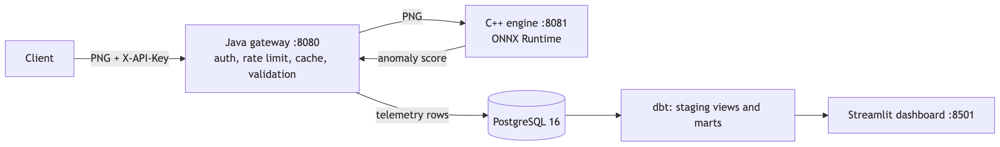
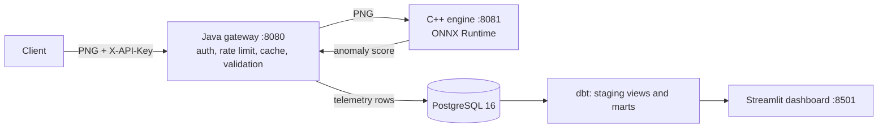

# InferenceStack

**Serve an industrial anomaly-detection model through a C++17 ONNX Runtime engine, a Java 21 Spring Boot gateway and PostgreSQL/dbt analytics, runnable with one Docker Compose command.** Model parity is tested against the PyTorch reference, with integration tests covering the serving stack end to end.

[](https://github.com/nithya-prakash/InferenceStack/actions/workflows/ci.yml)   


*Shows: real requests through gateway and engine (defective image, cache hit, good image, 401) and the Streamlit dashboard after 223 requests that replay MVTec `bottle` test images on a laptop. Does not show: a hosted deployment, real users, or time series (all requests landed in one hour).*

## Engineering Highlights

- **One owner per transformation:** resize in a Python utility; the engine only validates and decodes a 224x224 PNG; normalization and scoring live in the ONNX graph.
- **Engine:** fail-fast startup (a failed model load never reports ready), header-level PNG validation, 1 MiB limit, thread-safe shared session.
- **Gateway:** hashed API keys (constant-time compare), per-key rate limit, cache keyed on model version + image hash, timeouts mapped to 502/504, best-effort telemetry without keys or image bytes.
- **Measured:** the benchmark exposed a ~40 ms server stall (fixed) and showed C++ is not faster than Python ORT for the model itself.

## Results

Produced on 2026-10-09 by the scripts in the last column. The test split is MVTec AD's official `bottle` split (written by MVTec, not by me). Hardware: Apple M4, Docker VM with 10 CPUs.

| What was measured | Result | Size | Script |
|---|---|---|---|
| Image AUROC, `bottle` | **0.9873** | 83 images (63 defective, 20 good) | `model/build_model.py` |
| Recall / false-positive rate at threshold 18.30 | **0.889** (56/63) / **0.000** (0/20) | same | same |
| AUROC over all 15 categories (Python only) | mean **0.886**, lowest 0.724 (pill) | 1,725 images | `model/evaluate_all.py`, [per-category table](docs/CATEGORY_RESULTS.md) |
| ONNX vs PyTorch, max abs difference | 5.15e-05 (tolerance rtol 1e-4, atol 1e-3) | 6 synthetic images | `model/test_parity.py` |
| C++ engine tests | 25/25 pass | 25 cases | `engine/Dockerfile --target test` |
| Gateway tests (real engine + PostgreSQL) | 19/19 pass | 5 unit + 14 integration | `gateway/run-tests.sh` |
| dbt build/tests; marts vs hand-computed values | 44/44 pass; 6/6 marts match | 15-row fixture | `analytics/scripts/verify.sh` |
| Compose end-to-end | passed | full stack | `scripts/e2e.sh` |

Latency in ms (mean / median / p95 / p99), 300 timed calls after 30 warm-up, 1 thread, single run ([method](benchmarks/README.md), `benchmarks/bench.py`):

| Where | What | Latency |
|---|---|---|
| Linux container | Python ORT, in-process | 58.1 / 57.8 / 59.6 / 61.6 |
| Linux container | C++ engine `Run()` only | 58.8 / 58.5 / 60.5 / 66.1 |
| Linux container | C++ engine HTTP end-to-end | 59.3 / 58.9 / 61.1 / 66.8 |
| macOS host | PyTorch / Python ORT, in-process | 26.7 / 26.2 / 30.3 / 33.1 and 28.5 / 28.4 / 29.3 / 29.7 |

Engine throughput 16.9 req/s (1 client), 51.5 req/s (4 clients); RSS about 54 MB idle, 97 MB after load.

**Honest reading**
- **Strong:** the full path is tested end to end and every number is reproducible with the listed commands. `bottle` is one of the better categories.
- **Weak:** accuracy varies a lot by category (pill 0.724, screw 0.757, hazelnut 0.777); the conservative threshold rule gives low recall on many (cable 0.000, pill 0.064); the `bottle` threshold comes from 42 images.
- **Cannot prove:** 83 images with 20 good ones do not show a true false-positive rate of 0. Parity tests show ONNX equals PyTorch, not that either is accurate. C++ is **not** faster than Python ORT for inference (58.8 vs 58.1 ms).
- **Not measured:** benchmarks on x86_64 hardware and gateway throughput under load.

## Quickstart

Requires Docker with Compose v2 (about 8 GB for the Docker VM) and `python3`. No API key to obtain: the setup script generates a random local one. The first build takes several minutes.
```bash
./scripts/init-env.sh                 # writes a local, gitignored .env with random secrets
docker compose up -d --build --wait   # engine, gateway, postgres, dbt (one-shot), dashboard
set -a; . ./.env; set +a
curl -s -X POST -H "X-API-Key: $GATEWAY_API_KEY" -H 'Content-Type: image/png' \
     --data-binary @model/test_data/png/gradient.png localhost:8080/api/v1/predict
docker compose run --rm dbt build     # refresh the marts after new traffic
open http://localhost:8501            # dashboard; gateway is on :8080
docker compose down                   # add -v to delete the database volume
```
| Variable (`.env`, see `.env.example`) | Purpose |
|---|---|
| `POSTGRES_PASSWORD` | database password, used by gateway, dbt and dashboard |
| `GATEWAY_API_KEY` | the client key you send in `X-API-Key` (used by scripts and examples) |
| `GATEWAY_API_KEY_SHA256` | the only form the gateway sees (digest of the key) |
Other settings (timeouts, cache size/TTL, image size limit, rate limits) are environment variables listed in [gateway/README.md](gateway/README.md) and [engine/README.md](engine/README.md).

## How it works



<details><summary>Mermaid source</summary>


</details>

Stack: Python 3.12 / PyTorch 2.14.1 / ONNX 1.23.2; C++17 / ONNX Runtime 1.31.0 / cpp-httplib 0.18.3 / GoogleTest 1.15.2; Java 21 / Spring Boot 3.5.16 / Bucket4j 8.17.0 / Caffeine / Flyway; PostgreSQL 16 / dbt-postgres 1.11.0 / Streamlit 1.65.0; Docker Compose, GitHub Actions. Model: PaDiM-style detector (frozen ResNet18 features + per-position Gaussian statistics), details in [model/MODEL_CARD.md](model/MODEL_CARD.md).

## Usage

| Flow | Command / endpoint |
|---|---|
| Predict | `POST /api/v1/predict`, header `X-API-Key`, `Content-Type: image/png`, body = 224x224 8-bit RGB PNG (max 1 MiB) -> `{request_id, anomaly_score, is_anomalous, threshold, model_version, cached, engine_inference_ms}` |
| Prepare your own image | `python model/prepare_image.py in.jpg out.png` (needs Pillow) |
| Health | gateway `GET /health/live`, `GET /health/ready` (engine + database); engine `GET /health` |
| Errors | `{"request_id","error":{"code","message"}}` with 400, 401, 413, 415, 422, 429, 502, 504 (table in [gateway/README.md](gateway/README.md)) |
| Fill the dashboard | `python3 analytics/scripts/generate_traffic.py --requests 150 --mix success=60,cache_hit=30,invalid=10 --key "$GATEWAY_API_KEY"`, then `docker compose run --rm dbt build`. To replay real images: `python analytics/scripts/prepare_replay_images.py` (needs `data/mvtec/bottle`), then add `--image-dir data/replay` (each real image is sent once; once all are used, repeats are served from the cache) |
| Metrics | six dbt marts: volume, latency percentiles, error rate, per-key daily requests, cache hit rate, outcomes; definitions in [analytics/README.md](analytics/README.md) |
| Database | table `request_log` (Flyway `V1__request_log.sql`); no keys, headers or image bytes stored |

## Evaluation method

| Step | Detail |
|---|---|
| Data | MVTec AD (not committed): `bottle` has 209 good training images and an official test split of 83 (20 good, 63 defective). |
| Splits | seed 42: 167 images fit, 42 other good images calibrate the threshold (max score), the official test split is scored once. Other categories: calibration = 20% of training images. |
| Reproduce | `python model/build_model.py` (`bottle`), `python model/evaluate_all.py` (all 15), `python model/test_parity.py` (needs only committed files) |
| Discarded | an earlier predictive-maintenance model (replaced before any serving code existed; in git history only); a first benchmark inflated by a missing TCP_NODELAY (fixed, re-measured); a first traffic run whose outage requests were served from cache (generator bug, fixed) |

## Feature status

| Feature | Status |
|---|---|
| ONNX export with in-graph normalization, parity tests | implemented, tested |
| C++ `/health` and `/predict`, PNG validation, fail-fast load | implemented, tested |
| Hashed API keys, per-key rate limit, cache with model-version invalidation | implemented, tested |
| Timeouts, error mapping, request ids, PostgreSQL telemetry | implemented, tested |
| dbt staging + 6 marts, traffic generator, Streamlit dashboard | implemented, tested (fixture), run on simulated traffic |
| 15-category evaluation | implemented (Python only; only `bottle` is served) |
| Docker Compose stack, end-to-end script | implemented, run locally |
| GitHub Actions | implemented; all 5 jobs passed on GitHub's x86_64 runners (run 37943194993, commit c0468aa) |

## Limitations

- Served model covers one category; its test set is 83 images and its threshold uses 42 calibration images. Other categories are weaker (see Results); clean lab images only.
- Single-run benchmarks on one arm64 laptop; no x86_64 benchmarks. No load test, decoder fuzzing or image scanning.
- Gateway: API keys are bearer secrets and there is no TLS; rate limit and cache are per instance and reset on restart; a cache can serve old results after a model swap the gateway has not seen (until TTL); a failed telemetry insert loses that row.
- Analytics: marts are full-refresh; traffic is simulated (real MVTec images replayed, no real users); the dashboard has no auth and Compose uses one database user.
- No hosted demo. Running in containers does not make this production-ready.

## Repository layout

```
model/       scorer (padim.py), build_model.py, prepare_image.py, test_parity.py, MODEL_CARD.md, artifacts/ (ONNX + metadata), test_data/ (synthetic PNGs, reference.json)
engine/      C++17 engine: src/, include/, tests/ (GoogleTest), third_party/ (stb), CMakeLists.txt, Dockerfile
gateway/     Spring Boot gateway: auth, ratelimit, cache, engine client, telemetry, web; tests; Flyway migration; run-tests.sh
analytics/   dbt_project/ (staging, marts, tests), dashboard/ (Streamlit), scripts/ (verify.sh, generate_traffic.py), tests/ (fixture, expected values)
benchmarks/  bench.py and measured results
scripts/     init-env.sh, e2e.sh
docs/        demo.gif, INTERVIEW_GUIDE.md
.github/workflows/ci.yml   docker-compose.yml   .env.example   LICENSE
```

## Checks

| Check | Command |
|---|---|
| Model parity | `python model/test_parity.py` |
| C++ engine | `docker build -f engine/Dockerfile --target test -t t . && docker run --rm t` |
| Gateway | `gateway/run-tests.sh` |
| Analytics | `analytics/scripts/verify.sh` |
| Whole stack | `scripts/e2e.sh` |
No formatter, linter or type checker is configured. CI (`.github/workflows/ci.yml`) runs model parity, engine tests, gateway tests, analytics verify, then Compose end-to-end.

## Roadmap

Serve more MVTec categories with per-category thresholds, add a shared rate limit/cache, TLS and key rotation.

## License

Code: [MIT](LICENSE). The trained model in `model/artifacts/` is derived from MVTec AD (CC BY-NC-SA 4.0): **non-commercial use only**. The ResNet18 ImageNet weights (torchvision `IMAGENET1K_V1`) are embedded in that file; torchvision's code is BSD-licensed, but its metadata states no license for the weights and the ImageNet data has its own terms. I have not verified those terms, so review them before any use beyond personal or portfolio purposes. See [model/MODEL_CARD.md](model/MODEL_CARD.md).
