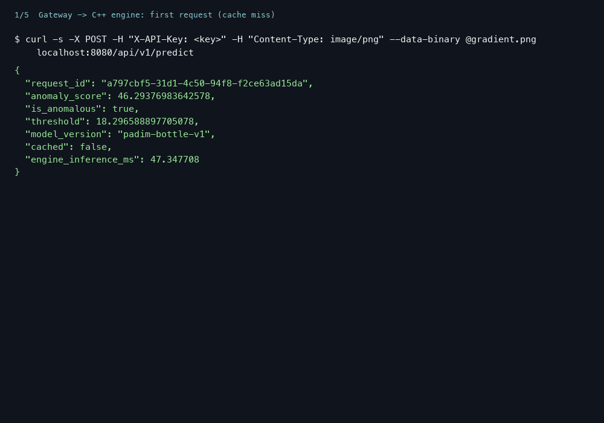
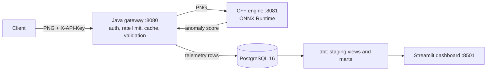

# InferenceStack

Serve an industrial anomaly-detection model through a **C++17 ONNX Runtime engine, a Java 21 Spring Boot gateway and PostgreSQL/dbt analytics**, with every layer parity-tested against the Python reference.

   
<!-- CI badge: add after the first push, once the workflow has actually run -->



*Shows: a real request through gateway and engine (cache miss, cache hit, rejected without a key) and the Streamlit dashboard reading the dbt marts after 153 synthetic requests on a laptop. Does not show: a hosted deployment, real factory traffic, or time series (all synthetic traffic landed in one hour, so the trend charts have a single point).*

## Results

Numbers come from the scripts named in the last column; hardware for latency: Apple M4, Docker VM with 10 CPUs. The test split is MVTec AD's official `bottle` split (written by MVTec, not by me).

| What was measured | Result | Size | Script |
|---|---|---|---|
| Image-level AUROC (PyTorch and ONNX identical) | **0.9873** | 83 test images (63 defective, 20 good) | `model/build_model.py` -> `model/artifacts/model_meta.json` |
| Defect recall / false-positive rate at the calibrated threshold (18.30) | **0.889** (56/63) / **0.000** (0/20) | same 83 images | same |
| ONNX vs PyTorch reference, max abs difference (scores and heatmaps) | 5.15e-05 (tolerance rtol 1e-4, atol 1e-3) | 6 synthetic images | `python model/test_parity.py` |
| C++ engine tests | 25/25 pass (arm64; amd64 emulated on the M4) | 25 cases | `engine/Dockerfile --target test` |
| Gateway tests (incl. real engine + PostgreSQL) | 19/19 pass | 5 unit + 14 integration | `gateway/run-tests.sh` |
| dbt build + tests; marts vs hand-computed values | 44/44 pass; all 6 marts match | 15-row fixture | `analytics/scripts/verify.sh` |
| Compose end-to-end | passed (6 reference images through the gateway match Python scores, 401, dbt, dashboard) | full stack | `scripts/e2e.sh` |
| Latency, in-process, 1 thread (mean / median / p95 / p99 ms) | Linux container: Python ORT 58.1 / 57.8 / 59.6 / 61.6; C++ engine `Run()` 58.8 / 58.5 / 60.5 / 66.1; C++ HTTP end-to-end 59.3 / 58.9 / 61.1 / 66.8. macOS host: PyTorch 26.7 / 26.2 / 30.3 / 33.1; Python ORT 28.5 / 28.4 / 29.3 / 29.7 | 300 timed calls, 30 warm-up, one run | `benchmarks/bench.py` ([method](benchmarks/README.md)) |
| Engine throughput / memory | 16.9 req/s (1 client), 51.5 req/s (4 clients); RSS about 54 MB idle, 97 MB after load | 10 s runs | `benchmarks/bench.py http` |
| Gateway throughput, x86_64 hardware, GitHub Actions run | **not measured** | | |

**Honest reading.** Strong: the whole path is tested end to end, and the numbers are reproducible with the listed commands. Weak: the accuracy claim rests on one product category and 83 images; with 20 good images, "0 false positives" does not mean the true false-positive rate is 0; the threshold is the maximum over only 42 calibration images. Parity tests prove ONNX equals PyTorch, not that either is accurate. **C++ is not faster than Python ORT for the model itself** (same runtime, 58.8 vs 58.1 ms); its benefit here is a small dependency-light server with about 0.5 ms request overhead. Host and container latencies are not comparable.

## Quickstart

Requires Docker with Compose v2 (about 8 GB for the Docker VM) and `python3`. No API key to obtain: the setup script generates a random local one. The first build takes several minutes.
```bash
./scripts/init-env.sh                 # writes a local, gitignored .env with random secrets
docker compose up -d --build --wait   # engine, gateway, postgres, dbt (one-shot), dashboard
set -a; . ./.env; set +a
curl -s -X POST -H "X-API-Key: $GATEWAY_API_KEY" -H 'Content-Type: image/png' \
     --data-binary @model/test_data/png/gradient.png localhost:8080/api/v1/predict
docker compose run --rm dbt build     # refresh the marts after new traffic
open http://localhost:8501            # dashboard; gateway is on :8080
docker compose down                   # add -v to delete the database volume
```
| Variable (`.env`, see `.env.example`) | Purpose |
|---|---|
| `POSTGRES_PASSWORD` | database password, used by gateway, dbt and dashboard |
| `GATEWAY_API_KEY` | the client key you send in `X-API-Key` (used by scripts and examples) |
| `GATEWAY_API_KEY_SHA256` | the only form the gateway sees (digest of the key) |
Other settings (timeouts, cache size/TTL, image size limit, rate limits) are environment variables listed in [gateway/README.md](gateway/README.md) and [engine/README.md](engine/README.md).

## How it works


Stack: Python 3.12 / PyTorch 2.14.1 / ONNX 1.23.2 (model), C++17 / ONNX Runtime 1.31.0 / cpp-httplib 0.18.3 / GoogleTest 1.15.2 (engine), Java 21 / Spring Boot 3.5.16 / Bucket4j 8.17.0 / Caffeine / Flyway (gateway), PostgreSQL 16 / dbt-postgres 1.11.0 / Streamlit 1.65.0 (analytics), Docker Compose, GitHub Actions.
Model: PaDiM-style anomaly detector (frozen ResNet18 features + per-position Gaussian statistics) fitted on defect-free MVTec AD `bottle` images; the score is the maximum Mahalanobis distance over a 28x28 feature grid. Preprocessing is owned once: `model/prepare_image.py` resizes/crops to 224x224 RGB PNG; the engine only validates and decodes; the ONNX graph does scaling and normalization. Details: [model/MODEL_CARD.md](model/MODEL_CARD.md).

## Usage

| Flow | Command / endpoint |
|---|---|
| Predict | `POST /api/v1/predict`, header `X-API-Key`, `Content-Type: image/png`, body = 224x224 8-bit RGB PNG (max 1 MiB) -> `{request_id, anomaly_score, is_anomalous, threshold, model_version, cached, engine_inference_ms}` |
| Prepare your own image | `python model/prepare_image.py in.jpg out.png` (needs Pillow) |
| Health | gateway `GET /health/live`, `GET /health/ready` (engine + database); engine `GET /health` |
| Errors | `{"request_id","error":{"code","message"}}` with 400, 401, 413, 415, 422, 429, 502, 504 (table in [gateway/README.md](gateway/README.md)) |
| Fill the dashboard | `python3 analytics/scripts/generate_traffic.py --requests 150 --mix success=60,cache_hit=30,invalid=10 --key "$GATEWAY_API_KEY"`, then `docker compose run --rm dbt build` |
| Metrics | six dbt marts: volume, latency percentiles, error rate, per-key daily requests, cache hit rate, outcomes; definitions in [analytics/README.md](analytics/README.md) |
| Database | table `request_log` (Flyway `V1__request_log.sql`); no keys, headers or image bytes stored |

## Evaluation method

| Step | Detail |
|---|---|
| Data | MVTec AD `bottle`: 209 good training images, official test split of 83 (20 good, 63 defective). Not committed (CC BY-NC-SA 4.0). |
| Splits | seed 42: 167 good images to fit, 42 other good images to calibrate the threshold (max score), the official test split only for the final numbers. |
| Reproduce accuracy | download `bottle` into `data/mvtec/`, then `python model/build_model.py` (prints and stores AUROC, recall, FPR) |
| Reproduce parity | `python model/test_parity.py` (needs only committed files) |
| Reproduce other numbers | commands in the Results table; benchmark commands in [benchmarks/README.md](benchmarks/README.md) |
| Discarded | an earlier predictive-maintenance (RUL) model and its artifacts, replaced before any serving code existed (history only); a first benchmark with a 99 ms end-to-end figure caused by a missing TCP_NODELAY (fixed, re-measured); a first synthetic-traffic run whose "outage" requests were served from cache (generator bug, fixed) |

## Feature status

| Feature | Status |
|---|---|
| ONNX export with normalization in-graph, parity tests | implemented, tested |
| C++ `/health`, `/predict`, PNG validation, fail-fast model load, concurrency | implemented, tested |
| API-key auth (hashed), per-key rate limit, cache with model-version invalidation | implemented, tested |
| Downstream timeouts and error mapping, request ids, PostgreSQL telemetry | implemented, tested |
| dbt staging + 6 marts + tests, traffic generator, Streamlit dashboard | implemented, tested (fixture) and run on synthetic traffic |
| Docker Compose stack and end-to-end script | implemented, run locally |
| GitHub Actions workflow | written and linted with `actionlint`, **never run on GitHub** |
| TLS, key rotation/revocation | not implemented |
| Shared (multi-instance) rate limit and cache | not implemented (in-memory per instance) |
| Telemetry retry queue | not implemented (a failed insert loses that row, logged and counted) |
| More than one MVTec category, heatmap in the API, localization | not implemented |
| Hosted demo, load test, decoder fuzzing, image scanning | not done |

## Limitations

- One category and 83 test images; threshold calibrated on 42 images; no confidence intervals; trained and evaluated on clean lab images only.
- Single-run benchmarks on one laptop (arm64); x86_64 engine tests ran emulated, and the gateway/analytics/e2e jobs only on arm64.
- Gateway: API keys are bearer secrets without TLS; rate limit and cache are per instance and reset on restart; a cache can serve old results after a model swap the gateway has not observed (until TTL).
- Analytics: marts are full-refresh; synthetic traffic only; the dashboard has no auth and Compose uses one database user.
- ONNX Runtime prints two telemetry init warnings at startup (events are disabled in code).
- No hosted demo. Running in containers does not make this production-ready.

## Repository layout

```
model/       scorer (padim.py), build_model.py, prepare_image.py, test_parity.py, MODEL_CARD.md, artifacts/ (ONNX + metadata), test_data/ (synthetic PNGs, reference.json)
engine/      C++17 engine: src/, include/, tests/ (GoogleTest), third_party/ (stb), CMakeLists.txt, Dockerfile
gateway/     Spring Boot gateway: auth, ratelimit, cache, engine client, telemetry, web; tests; Flyway migration; run-tests.sh
analytics/   dbt_project/ (staging, marts, tests), dashboard/ (Streamlit), scripts/ (verify.sh, generate_traffic.py), tests/ (fixture, expected values)
benchmarks/  bench.py and measured results
scripts/     init-env.sh, e2e.sh
docs/        demo.gif, INTERVIEW_GUIDE.md
.github/workflows/ci.yml   docker-compose.yml   .env.example   LICENSE
```

## Checks

| Check | Command |
|---|---|
| Model parity | `python model/test_parity.py` |
| C++ engine | `docker build -f engine/Dockerfile --target test -t t . && docker run --rm t` |
| Gateway | `gateway/run-tests.sh` |
| Analytics | `analytics/scripts/verify.sh` |
| Whole stack | `scripts/e2e.sh` |
| Workflow syntax | `docker run --rm -v "$PWD":/r -w /r rhysd/actionlint:1.7.7` |
No formatter, linter or type checker is configured for C++, Java or Python. CI (`.github/workflows/ci.yml`) runs: model parity, engine tests, gateway tests, analytics verify, then Compose e2e; it has not been observed running yet.

## Roadmap

Push and observe the first CI run, then add more MVTec categories, a shared rate limit/cache, TLS and key rotation, and a read-only dashboard database role.

## License

Code: [MIT](LICENSE). The trained model in `model/artifacts/` is derived from MVTec AD (CC BY-NC-SA 4.0) and is for non-commercial use only; see [model/MODEL_CARD.md](model/MODEL_CARD.md).
